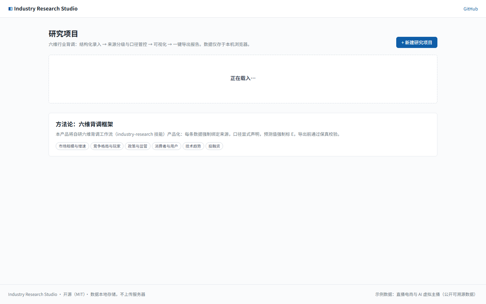
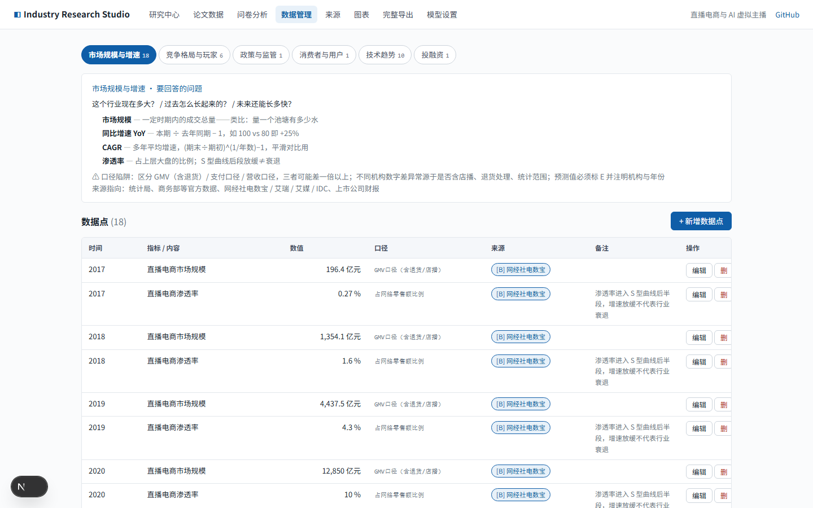
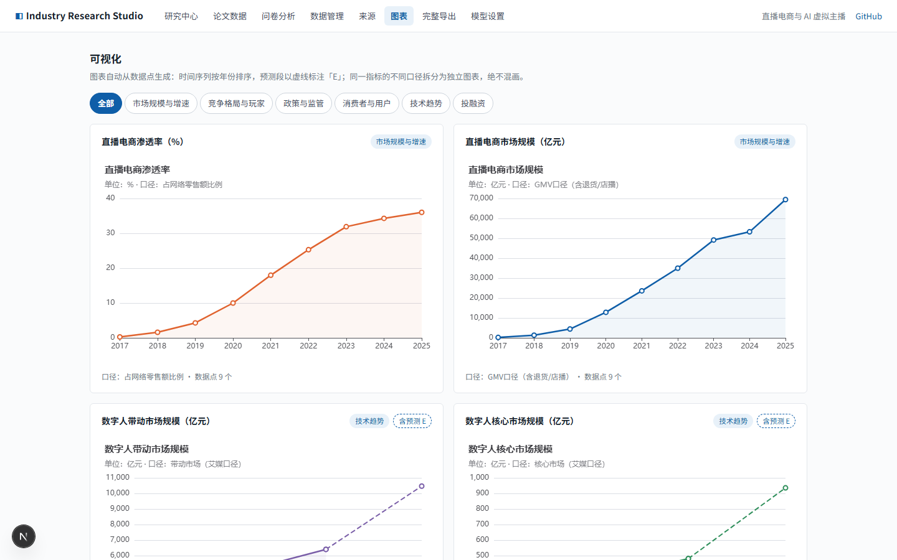
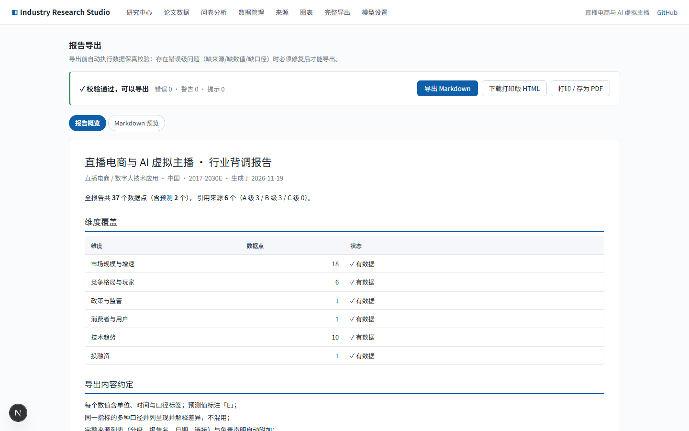

# Industry Research Studio · 行业研究工作台

把行业背调从「一堆散乱的收藏链接」变成「结构化、可校验、可导出」的工作流。

一个**本地优先**的行业研究工作台：结构化录入数据点，每条数据**强制绑定来源**并**显式声明口径**，自动交叉校验，一键生成可视化图表与可导出的研究报告；v0.2 新增**主动研究流水线**（公开链接提取 → 证据保存 → 逐行入选 → 论文数据统计 → 真实问卷导入与分析）与 **Electron 桌面版**（搜索、模型、代理等能力仅在本地主进程运行，密钥系统加密保存、不上传）。

- **线上预览**：https://industry-research-studio.vercel.app
- **方法论来源**：自研六维背调工作流（industry-research 技能，本产品为其图形化实现）
- **许可证**：MIT

## 界面

| 项目仪表盘 | 六维录入工作台 |
| --- | --- |
|  |  |

| 自动可视化（预测段虚线标 E） | 报告导出（校验门禁） |
| --- | --- |
|  |  |

## 为什么做这个

行业背调最常见的三个坑：**数字没来源**、**口径混着用**、**预测当事实**。本工具把这三条变成硬约束：

| 红线 | 产品化实现 |
| --- | --- |
| 每个数字可追溯 | 数据点必须绑定来源库中的来源，缺失则校验报错、阻断导出 |
| 口径显式声明 | 每条数据必填口径标签（如「GMV口径」）；同一指标的多种口径自动拆分，绝不混画在一条线上 |
| 预测 ≠ 事实 | 预测值强制标 `E`，图表虚线区分，报告与图表中明示预测机构 |

## 功能

- **项目管理**：多项目并行，项目含行业边界、地域、研究时段与启用维度
- **六维结构化录入**：市场规模与增速 / 竞争格局 / 政策监管 / 消费者 / 技术趋势 / 投融资，每个维度内置「要回答的问题 + 核心指标 + 口径陷阱 + 来源指向」指南
- **来源库**：A（官方/财报）/ B（机构研究）/ C（媒体线索）三级分级，引用计数、失效链接标注、被引用防误删
- **自动可视化**：时间序列（预测段虚线衔接）、主体横向对比柱状图，按维度筛选
- **报告导出**：Markdown（可直接粘贴飞书/语雀/Notion）、自包含打印版 HTML（浏览器打印为 PDF），附完整来源列表与免责声明
- **保真校验门禁**：缺来源 / 缺数值 / 缺口径 → 错误级，修复前禁止导出；口径冲突 / C 级孤证 / 链接失效 → 警告
- **本地优先**：全部数据存储在浏览器 IndexedDB，不上传任何服务器
- **研究中心（主动研究）**：公开链接 / PDF / CSV / XLSX / SPSS(.sav/.zsav) 提取 → 证据保存（原文 + 表格 + 校验和）→ 逐行入选为数据点；搜索（Tavily / Brave）、AI 检索词规划与证据评分
- **论文数据工作台**：研究问题与变量（X/M/Y/控制变量）、论文数据清单（分维度用途与缺口）、用户固定文献清单；不自动编造论文正文、问卷样本或参考文献
- **真实问卷分析**：CSV / Excel / SPSS 导入，描述统计、信效度、相关、回归与 Bootstrap 中介检验，清洗排除逐条留痕，不生成样本
- **完整导出中心**：Excel / CSV / Word / Markdown / 独立 HTML / PNG / SVG / ZIP 一键导出，全部来自同一份项目数据与统计结果
- **服务与模型设置（桌面版）**：Tavily / Brave 搜索 Key、主流模型与自定义 OpenAI 兼容中转、直连 / 跟随系统代理 / 自定义代理

## 技术栈

Next.js（App Router）+ TypeScript 严格模式 + Tailwind CSS 4 + Dexie（IndexedDB）+ ECharts 6 + Electron 45 + Vitest + Playwright

## 快速开始

```bash
npm install
npm run dev        # http://localhost:3000
```

首次打开自动注入示例项目「直播电商与 AI 虚拟主播」（全部数据来自公开可溯源来源，作为六维结构的演示样板）。

桌面版开发：

```bash
npm run desktop:dev   # 同时启动 Next dev（3100）与 Electron，自动打开桌面窗口
```

## 测试与构建

```bash
npm run test           # 单元测试（Vitest，69 个用例）
npm run test:e2e       # Web 端到端测试（Playwright，15 个用例，需先 npx playwright install chromium）
npm run test:electron  # Electron 桌面壳测试（Playwright，1 个用例）
npm run build          # 生产构建（next build + tsup 打包 Electron 主进程）
npm run lint           # ESLint
```

## 数据模型（核心概念）

```
Project       研究项目（边界/地域/时段/启用维度/论文配置）
  ├─ DataPoint     数据点：指标 + 数值/文本 + 时间 + 口径标签 + 来源 + 预测标记
  ├─ Evidence      证据：标题 + 原文 + 表格 + 采集方式 + 来源 + 校验和
  └─ Questionnaire 问卷数据集：表头 + 行数据 + 统计分析结果
Source        来源（全局共享库）：名称 + 报告全名 + 分级 A/B/C + 链接 + 可访问性
```

## 目录结构

```
app/                 页面：项目仪表盘、工作台（录入）、来源、可视化、报告导出、
                     研究中心、论文、问卷分析、完整导出、服务与模型设置
components/          Topbar、EChart 封装、研究中心/问卷分析组件
electron/            桌面主进程（main/preload）与搜索/模型/提取/授权浏览器服务
lib/                 types/db/validation/charts/export/framework/seed-data，
                     以及 research-workflow、evidence-score、source-catalog、
                     url-security、stats（问卷统计）、model-presets 等
tests/unit/          Vitest 单元测试
tests/e2e/           Playwright Web 端到端测试
tests/electron/      Playwright Electron 桌面壳测试
```

## 桌面版打包

```bash
npm run desktop:pack   # 生成解包目录（--dir，用于本机验证）
npm run desktop:dist   # 生成安装包：Windows NSIS + portable；macOS DMG/ZIP
```

- **Windows**：NSIS 安装器 + 便携版（x64）
- **macOS**：DMG / ZIP（arm64、x64），需在 macOS 上经 CI 构建（Windows 本机不能冒充已验证）
- **Linux**：AppImage

## 部署

任何支持 Next.js 的静态/Node 托管均可。以 Vercel 为例：

```bash
npx vercel --prod
```

数据存于访问者本地浏览器，服务端不保存任何业务数据。

## 免责声明

本工具输出的报告基于用户录入或示例的公开数据二次整理，不构成投资建议。标注「E」的数值为机构预测，不代表实际结果。制作过程中不生成、修改或虚构任何原始统计数据。

## 贡献

欢迎 Issue 与 PR，详见 [CONTRIBUTING.md](CONTRIBUTING.md)。
